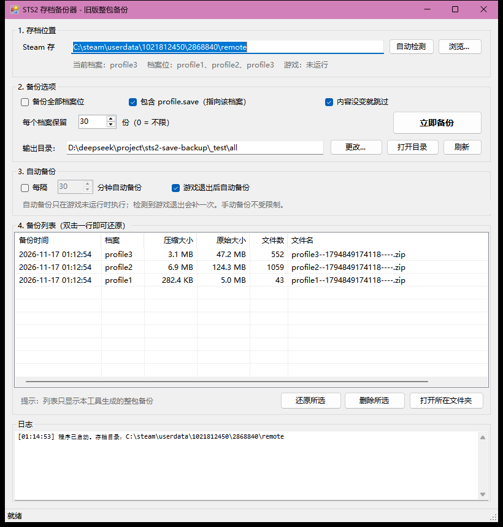

# STS2 存档备份器

> 面向《杀戮尖塔 2》（Slay the Spire 2）的本地整包存档备份与还原工具

<p align="left">
  
  
  
</p>

## 目录

- [项目简介](#项目简介)
- [背景](#背景)
- [功能特性](#功能特性)
- [界面预览](#界面预览)
- [下载与运行](#下载与运行)
- [使用说明](#使用说明)
- [备份格式](#备份格式)
- [命令行](#命令行)
- [与小黑盒 v2 的差异](#与小黑盒-v2-的差异)
- [从源码构建](#从源码构建)
- [项目结构](#项目结构)
- [数据与配置](#数据与配置)
- [已验证项目](#已验证项目)
- [常见问题](#常见问题)
- [已知限制](#已知限制)
- [版本记录](#版本记录)
- [使用许可](#使用许可)

## 项目简介

STS2 存档备份器是一款运行于 Windows 的本地存档备份工具，用于《杀戮尖塔 2》（Steam AppID `2868840`）。

工具采用与小黑盒旧版备份相同的“整包”思路：将一个档案目录完整打包为一个 ZIP 文件，文件名保持 `profile3--<毫秒时间戳>----.zip` 的形式。与逐文件备份相比，整包备份不依赖外部清单，单个 ZIP 即为一份完整、可独立还原的快照。

程序为绿色免安装版本，不修改游戏文件，不访问网络，所有备份均保存在本机。

## 背景

小黑盒新版 v2 存档备份采用“一文件一 ZIP + manifest”的结构，但单次备份存在 **500 个文件的上限**。

以本机 `profile3` 为例：

| 项目 | 数量 |
| --- | --- |
| `history` 实际局数 | 544 |
| 小黑盒 v2 实际备份 | 492 |
| 被截断 | 52 |

被截断的部分主要是 `history/*.run` 逐局记录。核心进度 `progress.save` 不受影响，但较早与较晚的对局记录会不完整。

本工具使用整包方式，不受单次文件数量限制，可将 `profile3` 的 544 局记录完整纳入同一份备份。

## 功能特性

- **整包备份**：一个档案对应一个完整 ZIP，包含 `saves`、`history`、`mods`、`replays`。
- **无 500 文件限制**：历史记录不截断。
- **多档案支持**：可只备份当前档案，也可一次备份 `profile1` / `profile2` / `profile3`。
- **独立可还原**：可选在 ZIP 根目录写入 `profile.save` 与 `settings.save.backup`，还原到新环境后仍指向正确档案。
- **重复检测**：根据文件路径、大小与修改时间生成指纹，内容未变化时跳过重复备份。
- **保留策略**：每个档案保留最近 N 份，自动清理旧备份；仅清理本工具生成且带 `.meta.txt` 的记录，不误删小黑盒旧包。
- **自动备份**：
  - 游戏退出后自动备份；
  - 支持按固定分钟间隔备份；
  - 仅在游戏未运行时执行，避免读取写入中的存档。
- **安全还原**：还原前将目标位置将被覆盖的文件备份到独立目录。
- **兼容旧包**：可直接还原小黑盒旧版整包 ZIP，并可选择切换当前档案。
- **命令行模式**：提供 `sts2-backup-cli.exe`，便于脚本化与计划任务。

## 界面预览



## 下载与运行

### 环境要求

| 项目 | 要求 |
| --- | --- |
| 操作系统 | Windows 10 / Windows 11（64 位） |
| 运行时 | .NET Framework 4.8（Windows 10/11 通常已内置） |
| 磁盘空间 | 程序约 100 KB；备份体积约为存档原始大小的 7% |

### 获取程序

下载仓库根目录的压缩包：

```text
STS2存档备份器_v1.0.zip
```

解压到固定目录后运行：

```text
STS2存档备份器_v1.0\STS2存档备份器.exe
```

> 请勿直接在压缩包内运行。程序未进行数字签名，首次运行时 Windows SmartScreen 可能提示“未知发布者”，选择“更多信息 → 仍要运行”即可。

### 快速开始

1. 启动 `STS2存档备份器.exe`。
2. 程序会自动检测 Steam 存档目录，通常为：
   ```text
   C:\steam\userdata\<Steam账号>\2868840\remote
   ```
   如未检测到，可点击“浏览...”手动选择 `remote` 文件夹。
3. 确认输出目录，默认路径为：
   ```text
   文档\STS2存档备份\<Steam账号>\2868840
   ```
4. 点击“立即备份”。
5. 建议勾选“游戏退出后自动备份”。

## 使用说明

### 手动备份

在主界面点击“立即备份”，程序会为当前 `profile.save` 指向的档案生成一份完整 ZIP。

勾选“备份全部档案位”后，会为 `profile1`、`profile2`、`profile3` 分别生成独立 ZIP。

### 自动备份

自动备份提供两种触发方式：

- **游戏退出后**：每 10 秒检测一次 `SlayTheSpire2.exe` 进程，检测到退出后执行备份。
- **定时备份**：按设定的分钟间隔执行。

自动备份仅在游戏未运行时执行；若定时时间到达时游戏仍在运行，本次备份会跳过并写入日志。

程序需要保持运行（可最小化）才能执行自动备份。

### 还原备份

1. 退出游戏。
2. 在 Steam 中暂时关闭该游戏的云同步，或让 Steam 进入离线模式。
3. 在备份列表中选择目标备份，点击“还原所选”，或直接双击该行。
4. 程序会将 ZIP 内容解压回 `remote` 目录，并将将被覆盖的现有文件保存到：
   ```text
   <输出目录>\_restore_backup_<时间戳>\
   ```
5. 启动游戏确认存档无误后，再恢复 Steam 云同步；若出现冲突提示，选择本地文件。

若还原的是不含 `profile.save` 的小黑盒旧包，程序会询问是否将当前档案切换为该备份对应的档案位。

## 备份格式

每份备份为一个独立 ZIP：

```text
profile3--1794849911689----.zip
├─ profile3/
│  ├─ saves/
│  │  ├─ progress.save
│  │  ├─ progress.save.backup
│  │  ├─ prefs.save
│  │  ├─ prefs.save.backup
│  │  ├─ history/
│  │  │  └─ *.run
│  │  └─ mods/
│  │     └─ <Mod名称>/*.save
│  └─ replays/
│     └─ latest.mcr
├─ profile.save                 （可选）
└─ settings.save.backup         （可选）
```

- 文件名中的数字为 Unix 毫秒时间戳。
- ZIP 内路径与 `remote` 目录一致，可直接解压到 `remote` 根目录。
- 勾选“包含 profile.save”时，ZIP 根目录会写入一个指向该档案的 `profile.save`，并附带当前 `settings.save.backup`。
- 每个 ZIP 旁会生成同名 `.meta.txt`，记录档案、文件数、原始大小、指纹和来源路径，便于管理和清理。

## 命令行

命令行程序：

```text
STS2存档备份器_v1.0\sts2-backup-cli.exe
```

### 参数

| 参数 | 说明 |
| --- | --- |
| `--source <目录>` | Steam `remote` 目录，默认自动检测 |
| `--output <目录>` | 备份输出目录，默认 `文档\STS2存档备份\<账号>\2868840` |
| `--all` | 备份全部档案位，默认只备份当前档案 |
| `--no-root` | 不写入 `profile.save` 与 `settings.save.backup` |
| `--no-skip` | 内容未变化时也强制新建备份 |
| `--keep <N>` | 每个档案保留最近 N 份，`0` 表示不限 |
| `--list` | 列出备份 |
| `--restore <zip>` | 还原指定备份到 `--source` |
| `--switch` | 还原后切换当前档案（配合 `--restore`） |
| `--help` | 显示帮助 |

### 示例

```powershell
# 备份当前档案
.\sts2-backup-cli.exe `
  --source "C:\steam\userdata\1021812450\2868840\remote" `
  --output "D:\STS2Backup"

# 备份全部档案位，每个档案保留 20 份
.\sts2-backup-cli.exe `
  --source "C:\steam\userdata\1021812450\2868840\remote" `
  --output "D:\STS2Backup" `
  --all --keep 20

# 列出备份
.\sts2-backup-cli.exe --output "D:\STS2Backup" --list

# 还原指定备份并切换当前档案
.\sts2-backup-cli.exe `
  --source "C:\steam\userdata\1021812450\2868840\remote" `
  --output "D:\STS2Backup" `
  --restore "D:\STS2Backup\profile3--1794849911689----.zip" `
  --switch
```

## 与小黑盒 v2 的差异

| 项目 | 小黑盒 v2 | 本工具 |
| --- | --- | --- |
| 打包方式 | 每文件一个 ZIP + manifest | 每档案一个完整 ZIP |
| `profile3` 历史记录 | 492 局（受 500 文件上限影响） | 544 局全量 |
| 单次文件数上限 | 500 | 无 |
| 回放文件 | 不包含 | 包含 `replays/latest.mcr` |
| 其他档案位 | 仅当前档案 | 可备份全部档案 |
| 自动备份 | 由小黑盒触发 | 本地定时 / 游戏退出触发 |
| 还原粒度 | 可按文件 | 整包还原，还原前自动保留旧文件 |
| 旧版整包 ZIP | 不适用 | 可直接还原 |
| 云端备注 | 服务端字段 | 不涉及（见常见问题） |

## 从源码构建

源码位于 `STS2存档备份器_v1.0/src/Sts2SaveBackup.cs`，使用 C# 5 与 WinForms 编写。

### 构建环境

- Windows 10 / 11
- .NET Framework 4.x（使用系统自带 `csc.exe`）

### 构建命令

```powershell
cd STS2存档备份器_v1.0
powershell -NoProfile -ExecutionPolicy Bypass -File .\build.ps1
```

构建完成后生成：

```text
dist\STS2存档备份器.exe
dist\sts2-backup-cli.exe
```

## 项目结构

```text
.
├─ README.md
├─ STS2存档备份器_v1.0.zip
└─ STS2存档备份器_v1.0/
   ├─ STS2存档备份器.exe
   ├─ sts2-backup-cli.exe
   ├─ build.ps1
   ├─ README.md
   ├─ assets/
   │  └─ app.ico
   ├─ docs/
   │  └─ screenshot.png
   └─ src/
      └─ Sts2SaveBackup.cs
```

## 数据与配置

| 内容 | 默认位置 |
| --- | --- |
| 设置与日志 | `%APPDATA%\STS2SaveBackup\settings.ini`、`backup.log` |
| 便携模式回退 | 程序目录下的 `data\`（当 `%APPDATA%` 不可写时） |
| 默认备份目录 | `文档\STS2存档备份\<Steam账号>\2868840` |
| 还原前备份 | `<输出目录>\_restore_backup_<时间戳>\` |

程序不会修改注册表，不会创建系统服务，不会访问网络。

## 已验证项目

以下结果基于 2026-11-17 的本机环境测试：

- `profile3` 备份生成 552 个条目（550 个存档文件 + `profile.save` + `settings.save.backup`）；
- 原始大小 47.2 MB，压缩后 3.1 MB；
- 552 个条目与实机存档逐文件 SHA-256 比对全部一致；
- 544 局历史记录完整入包；
- 还原到空目录后 552 个文件哈希全部一致；
- 可正常还原小黑盒旧版 `profile3--1794720774229----.zip`，展开 540 个文件；
- 重复检测、保留份数、GUI 备份、列表显示均已验证。

## 常见问题

### 为什么上传到小黑盒云存档后没有备注？

小黑盒云存档的“备注”是服务端独立字段，不在 ZIP 内。其上传接口只提交文件名、大小和修改时间，不提交备注；云端新记录默认显示为“黑盒云存档”。

这与本工具的备份内容无关。需要在小黑盒云存档卡片上使用“编辑存档备注”手动设置。

### 为什么自动备份没有执行？

请确认：

1. 程序仍在运行；
2. 已勾选“游戏退出后自动备份”或“定时备份”；
3. 自动备份触发时游戏确实未运行。

游戏运行中的定时备份会被跳过，这是为了避免读取到写入中的存档。

### 还原后 Steam 提示云存档冲突怎么办？

选择本地文件。还原前建议先关闭该游戏的 Steam 云同步，确认无误后再重新开启。

### 是否支持 Mod 存档？

当前版本只备份 `remote\profile1`、`profile2`、`profile3`，不包含 `remote\modded\` 这个 Mod 平行目录。若需要备份 Mod 模式存档，应单独复制 `modded` 目录。

### 是否会被游戏或平台判定为作弊？

本工具只在本机复制和还原存档文件，不修改游戏内存、不注入进程、不访问网络，也不参与联机同步。

## 已知限制

- 仅支持 Windows。
- 程序未进行代码签名，首次运行可能出现 SmartScreen 提示。
- 自动备份需要程序保持运行。
- 不备份 `remote\modded\` 与 `profile.save.backup`。
- 不提供云同步功能；如需异地保存，可将输出目录放入 OneDrive、坚果云等同步盘。
- 手动在游戏运行时强制备份，仍可能得到不一致的快照，建议退出游戏后备份。

## 版本记录

### 1.0.0（2026-11-17）

- 首个版本；
- 支持整包备份、全部档案位、自动备份、重复检测、保留策略；
- 支持整包还原与旧版小黑盒 ZIP 还原；
- 提供 GUI 与命令行两种模式。

## 使用许可

本项目为个人自用工具，源码公开仅供学习与参考，未附带开源许可证。未经作者许可，请勿用于商业分发。
